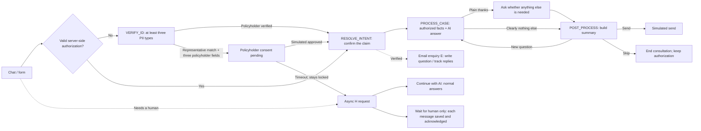

# Insurance SOP Service Platform · Technical Guide

Version 1.7.5 · 2026-11-16. Built from the assignment, the product guidance and the pre-submission bug list. The server enforces every hard gate; the AI writes natural-language explanations and summaries from authorized facts only. The 1.7.3 five-page PDF export is kept in `history/`; this Markdown file is the current reference.

**What changed in 1.7.5.** A representative pushing back while consent is pending gets one acknowledgment, the reason (claim details are the policyholder's private information; consent protects the policyholder even from family) and the two ways forward (Check policyholder consent, Request human help) instead of the pending template. The second verification refusal names Request human help explicitly; the third stops asking for identity details, even when it is an SSN refusal. Each reply carries at most one empathy sentence (`engine.limit_empathy` removes any extra acknowledgment, never content). The app version has a single source (`app.__version__`) used by `/healthz`, `/v1/config` and the OpenAPI document.

**What changed in 1.7.4.** When the model's wording fails validation, the model is unreachable, or the per-conversation call limit is reached, the app falls back to deterministic server templates built from the fixtures (status, amounts, denial reason, deadline, documents) instead of returning an error; an unreachable model adds a visible note. A verified policyholder asking about someone else's policy or claim is refused without losing their own verification and without entering representative mode; representative mode can be left with "I am the policyholder" or by submitting one's own identity. Failed identity checks are counted per browser owner and lock for 30 minutes after three failures (a new session, a subject change or logout does not reset the count). A mismatch only says "one or more details don't match our records" — no field hint and no "policy number". Replies before verification never repeat a claim ID or imply that a claim exists. When several claims match, the server lists them and answers the pending question once one is chosen. The last four digits of a national ID serve as the ID field for policyholders who have no SSN. Representative next steps name who acts.

## 1. Workflow and entry points

Every conversation follows **VERIFY_ID → RESOLVE_INTENT → PROCESS_CASE → POST_PROCESS**. A claim intent mentioned early can be remembered, but no claim is read or disclosed before verification. Human requests are an asynchronous side path and never interrupt the AI's main flow.



| Entry point | Purpose | Tracking and limits |
| --- | --- | --- |
| My claims | All of the caller's own claims; look up candidates by policy number, switch by claim ID | No match keeps the current claim; nobody else's records are revealed |
| Human requests | Asynchronous review requests for a representative, never a live human chat | H number, identity context, discussion, open questions, reason; view / cancel |
| Continue with AI / Wait for human only | Choose AI answers or only save messages | The latter acknowledges each message; the UI always labels the AI |
| Email enquiry | Send a question to the simulated insurer help desk | E number, simulated send / reply / follow-up, tied to the person and claim |
| Finish consultation / natural ending | Required summary flow; copy sent to the customer | Conclusion → Discussion → Next steps → References; customer chooses Send / Skip |

All representative handling, contacts and emails are simulated. A real integration would contact people through the registered email or phone; this demo contacts no one and promises no response time. Simulated feedback is demonstrated with the request's Demo controls. Old live-chat requests are migrated automatically; the live agent console was removed.

## 2. Identity, context and recovery

**Authorization is separate from the conversation.** An HttpOnly, SameSite cookie holds only a random owner token. The server's `authorizations` table stores an encrypted grant: caller (who is speaking / their role), data_subject (the policyholder / party_id), matched fields, epoch, and issued / last-activity / absolute-expiry times. Chat, account, history and email all use it. New session only starts a new conversation and clears the current claim; new tabs reuse the grant automatically. Logout / Switch caller revokes the grant for every conversation.

**Revocation and expiry.** Grants expire after 30 minutes idle or two hours absolute. Real input or clicks extend the idle timer; polling does not. `authorization_epoch` increments on revocation and is checked on every read and write. Logout revokes in-flight leases and cancels unsent summaries; stale requests cannot restore access. When a grant ends, the visible conversation is cleared and the welcome message returns; claims, H numbers, counts, messages and earlier diagnostics stay hidden until the caller verifies again. Cookies are not shared across browsers or devices.

**Verification gate.** At least three of name, DOB, registered phone, registered email and SSN last four must match the same person; policyholders whose record holds a national ID use its last four instead of SSN digits (the two are not interchangeable). Policy and claim IDs, and repeated aliases, do not add to the count. Partial answers, full resubmission, corrections and alternative fields are supported; any single mismatch fails the attempt and the reply never says which field. Failures are counted per browser owner; three failures lock for 30 minutes, during which correct data is refused too and a human option is offered. The assistant stops persuading a caller who keeps refusing. After success the identity is stated; an approved representative first confirms the authorization with David, then gives claim IDs / dates, and handles details only after confirmation.

**Representatives.** David's name must match `representatives.json`; Margaret's three fields are checked separately and cannot be mixed with David's. A relationship record is not an authorization. In `consent_scenarios.json` the simulated status starts as pending, then becomes approved or timeout; only a server-side approval grants a Margaret-scoped grant. A timeout stays locked and creates an H request with a receipt. The consent approval and the caller's name come first in the reply; the wait is explained only once. The UI marks consent as simulated; a caller claiming "they agreed" in chat cannot grant access.

**Context.** Unverified claim hints are only user statements; after verification the facts are looked up. Identity messages mask only the PII fragments and keep content like "my denied healthcare claim from January". Consultation memory is keyed by owner, caller, subject, episode, auth_epoch and case, up to eight turns. Switching claims within a consultation restores that claim's discussion; a new consultation reuses only the grant and never imports old dialogue; summaries describe only what was actually answered in this one. `pending_topics` survive identity, consent and claim selection; they are answered once the claim is confirmed and cleared only on success, and are not carried to a different claim. A representative only sees the H/E/email threads they started and cannot read the policyholder's earlier conversations. A policy or claim lookup with no match never overwrites the current selection.

**Humans and interruptions.** H requests are stored separately; after verification only anonymous requests from the same conversation and epoch are bound to the person; unverified accounts show an empty list. Create, reuse, bind, note and status updates are recorded in one transaction with a visible receipt; the model cannot delete them. In AI mode the assistant first asks whether to add a representative-decision question; the existing H request is updated only on a yes. A decline, new topic, claim switch or stale revision invalidates the offer; the AI never approves, extends or pays. Wait-for-human-only mode calls no model and writes the note and acknowledgment atomically. Returning to AI or starting a new conversation reminds the caller of open requests. Cancel, Stop and Reset are protected by version / lease / idempotency, so a late answer cannot overwrite newer input.

**Emotion and scope.** Emotion must be grounded in the current message and is not inherited from earlier turns; empathy is not repeated and is followed by the SOP reason and the next step. SSN refusal uses a fixed capability configuration that lists the other four fields and a human option. Notifications are mentioned (as "no notification on record") only when asked. Unrelated knowledge such as "RL" is declined; an abbreviation that might come from a claim form is clarified once and declined if the caller says it is unrelated. Repeated off-topic questions trigger a human option without forcing it.

## 3. Modules and key functions

Each turn: validate input → acquire lease → structured observation → server-side verification / routing → fetch authorized facts → AI writing → literal and semantic validation → atomic commit. The model cannot grant identity, choose a party, change status or amounts, or confirm a send on the customer's behalf.

| Module / function | Responsibility |
| --- | --- |
| `authorization.py / _authorization, _sync_authorization, _commit_authorization, logout` | Shared grant, expiry, epoch, revoking in-flight work; migrating existing grants |
| `representatives.py / _identify_representative, _check_representative_consent, _leave_representative_mode` | Relationships, subject separation, simulated consent, timeout, exit; the model cannot authorize |
| `consultation.py / caller_context, migrate_consultation, correspondence_visible` | Separating caller from policyholder; old representative drafts invalidated but grant kept; thread isolation |
| `capabilities.py / INTERFACE, SSN_ALTERNATIVES` | Fixed configuration of real UI capabilities, field alternatives and permissions |
| `engine.py / turn, _merge, _verify_identity, _server_guards` | Four-phase orchestration, merging source fragments, committing verification, other-party and redirect refusals, modes and closing intent |
| `Engine._compose, _post, _finish` | Authorized model context, summary generation with template fallback, atomic persistence and reply |
| `interpreter.py / ModelInterpreter.observe, OfflineInterpreter` | Turns the current message into a strict Observation (scope / emotion / human-decision); scripted parser used offline and as fallback |
| `responder.py / GroundedResponder.answer, validate_references` | AI answers / summaries, citation, date and amount checks, semantic review; at most one repair |
| `claims.py / verify, Gateway.account/find_cases/get_claim` | Three-PII same-person verification; phase, identity and claim-ownership checks |
| `next_steps.py / next_steps` | The deadline and open H requests determine the single available next step, naming the actor; shared by chat, buttons and email |
| `privacy.py / redact`; `summaries.py / summary_context` | PII fragment masking; structured customer-facing summary facts and references |
| `case_lookup.py / reference_lookup, restore_after_no_match` | Policy candidates, claim switching, recovery after no match |
| `store.py / begin, commit, control, activity, dispatch, record_verify_failure` | SQLite transactions, idempotency, CAS, leases, idle renewal, simulated outbox, verification lockout |
| `handoff_store.py / prepare_handoff, append_request_note, handoff_update` | Async requests, identity binding, atomic notes, feedback and cancel, legacy migration |
| `inquiries.py / create_inquiry, update_inquiry, dispatch_inquiries` | Separate E enquiry threads, simulated send and reply |
| `main.py`; `static/client.js, app.js, portal.js` | API / cookies; timeout recovery, chat and personal portal |

Stored data covers authorizations, sessions, turns, audit, profile/case_memory, handoffs, inquiries, outbox and verification-failure counters. Sensitive payloads use Fernet; the cookie holds only an unguessable token and the database stores an owner fingerprint. H/E numbers locate records but are not access credentials.

CL-2048's deadline is 2026-03-18. After it passes, the evidence bundle no longer offers actionable document-submission guidance, only representative review; document names can still be explained as historical facts. Representative claim pickers are titled with the policyholder's name; emails distinguish the recipient from the person who asked, and the server replaces "The representative asked" with the verified representative's name; Next steps say whether the representative or the policyholder acts. Summaries are regenerated from the latest facts; every date and amount needs a tool fact, and unknown notifications, exceptions or processing times are never invented.

## 4. Key APIs and error contract

| Method and path | Input / output | Core constraints |
| --- | --- | --- |
| `POST /v1/sessions` | Create a conversation, set the HttpOnly cookie; reuse a valid grant | A new conversation does not sign out; returns open-H reminders |
| `POST /v1/auth/logout` | Revoke the owner's grant, return a new epoch | All tabs and in-flight requests are invalidated together |
| `GET /v1/sessions/{sid}` | Phase, auth, messages, requests, suggestions, drafts | Syncs the shared grant every time; expiry hides private content |
| `POST .../{sid}/messages` | message_id, expected_version, text, action; optional form / offer_id | Idempotent + versioned; the model cannot supply authorization fields |
| `POST .../{sid}/activity` | Returns verified | Only extends a valid grant, never past absolute expiry |
| `GET .../{sid}/account` | profile, claims, emails, inquiries | Same grant; own records only |
| `GET /v1/handoffs/{H}?session_id=...` | Request summary, status and timeline | Valid grant + owner + same party; a representative must also be the creating caller |
| `POST /v1/handoffs/{H}/updates` | note / cancel / demo_acknowledge / demo_reply / demo_close | message_id + expected_revision; feedback is labelled simulated |
| `POST /v1/handoffs/{H}/cancel` | cancel | Closed requests accept no further notes |
| `POST .../{sid}/inquiries` | subject, body, optional case_id → E number | Verification and claim ownership; fixed simulated recipient |
| `GET/POST .../{sid}/inquiries/{E}` | view / followup / demo_reply / close / cancel | owner + party + revision + idempotency |
| `GET .../{sid}/trace` | Redacted events and model token metrics | Old epochs filtered out; no H / representative events before verification |

`messages.action`: message, form, human, wait_human, resume, confirm_claim, handoff_note_accept / decline, consent_check, consent_timeout, finish, email_send, email_skip, email_edit, interrupt, reset. Text and form cannot be sent together. Blank / oversized input or extra authorization fields return 422; no access returns 401/403/404; version conflicts 409; rate limits 429. Errors never corrupt the last confirmed state.

```json
{"message_id":"unique-request-id","expected_version":12,"action":"form","form":{"policy_number":"POL-9921"}}
```

Summary consent is bound to the offer, recipient, body hash, episode, auth_epoch and an expiry. A new question pauses the draft; an edit creates a new offer that must be confirmed again. Authorization and consent are re-checked before sending. E enquiries are independent of the summary; continuing to chat does not withdraw an E enquiry that was explicitly submitted. The summary is only ever sent to the policyholder's registered email; requests to send it elsewhere are refused without affecting verification.

`consent_check` only advances the current pending server-side simulation; `consent_timeout` switches to the timeout drill, which times out after at most four checks. Emails have four sections; the server inserts the representative's name and the policyholder's approval into Discussion, and the model may not impersonate the caller or rewrite the authorization. The recipient is labelled "the policyholder's registered email"; the demo disclaimer is in the footer and the chat card offers Send / Skip.

Full contracts: `docs/contracts`; a running server serves interactive API docs at `/docs`. `/healthz` is the readiness check.

## 5. Running, acceptance and iteration

**Start.** Copy `.env.example` to `.env`, set `MODEL_MODE=openai` and `MODEL_API_KEY`, then run `docker compose up --build -d`. Alternatively install `requirements.txt` and run `uvicorn app.main:app --host 127.0.0.1 --port 8000 --no-access-log` (use `--host 0.0.0.0` for direct server access). The key can also come from `OPENAI_API_KEY` or `MODEL_API_KEY_FILE` and always stays on the server.

**Docker.** Runs as non-root, persists the database and encryption key in `/data`, health check `/healthz`. The 1.7.5 image was built, run and accepted on Docker Engine 29.6 (real model, volume, restart, logout). Minimal start: `docker build -t insurance-sop .` and `docker run -p 8000:8000 -e MODEL_API_KEY=… insurance-sop`. Volume, `.env` and restart options are in the README.

**Offline vs real model.** Without a key the app runs in offline mode, a clearly labelled scripted walkthrough that does not represent natural-language quality. In real mode the model observes, writes and reviews. Wording that fails validation is replaced by the server's deterministic template; an unreachable model, a spent budget or the per-conversation call limit (`MODEL_MAX_CALLS_PER_CONVERSATION`, default 300, reset by New session) hands over to the scripted parser with a visible note; every gate stays the same. The test-budget ledger in `evals/live_demo.py` still works and also falls back instead of breaking the conversation.

| Acceptance area | Automated evidence |
| --- | --- |
| 1.7.5 consent explanation, refusal wording, single empathy line, version source | `tests/test_revision_v175.py` |
| 1.7.4 submission bugs: budget / validation fallback, other person's policy, cumulative lockout, mismatch wording, ambiguity, representative wording, redirect | `tests/test_submission_bugs.py`; `test_revision_v174.py` |
| Real-model end-to-end matrix (17 cases, 148 checks, including an invalid key) | `evals/e2e_matrix.py` → `docs/e2e-results.json` |
| 17 cross-phase questions / retries / claim switches / email wording; 33 earlier privacy and authorization checks | `tests/test_revision_v171.py`; `test_revision_v17.py` |
| Earlier representative consent, cross-person privacy, action receipts, emotion, aliases | `tests/test_revision_v16.py` |
| Shared grant, expiry / logout / late answers, idempotency | `tests/test_revision_acceptance.py` |
| Three PII types, alternative fields, early hints, corrections, injection and malformed input | workflow / semantic_edges / requirement_journeys tests |
| Claim / policy switching, cross-person isolation, email consent, interruption | policy_case_switch / case_memory / consistency / interruptions |
| Real browser: both waiting modes, new tab, New session, E/H, natural ending, logout | `evals/representative_browser.py`; `review_browser.py` |
| Blank page / timeout / blocked storage, stale HTTP response races | `evals/startup_browser.py`, `evals/interrupt_browser.py` |
| Real model: emotion, scope, partial identity, context, overdue representative decisions, structured email | `evals/revision_language.py`; earlier failing and final results in `docs/history/` |

**Reproduce.** Install `requirements-dev.txt`, then run `python -m pytest -q`, `ruff check app tests evals` and `ruff format --check app tests evals`. With Playwright and Chromium installed, run `review_browser.py` against an offline server. Exact counts, model version, results and spend are in [VALIDATION.md](VALIDATION.md); historical reports are not reruns of this version.

**Limits and next steps.** The fixtures are unchanged; each person has one policy, so a real multi-policy system must supply explicit policy→claim ownership. Three-PII matching is the assignment's requirement, not production-grade authentication. Real insurer systems, mailboxes and cross-device accounts are out of scope. When adding external adapters, keep the authorization, epoch, idempotency and feedback contracts; never hand business decisions to model text. Model review has limits, so acceptance combines deterministic constraints, real-model transcripts and browser results. Older representative conversations and unsent drafts are withdrawn while the grant is kept; the caller selects the claim again to review the summary.
